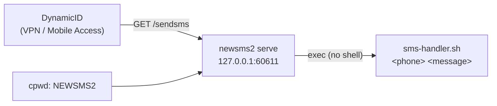

# newsms2

DynamicID SMS relay for Check Point Gaia: one static Go binary, supervised by WatchDog (cpwd), listening on loopback only.

## How it works



- DynamicID calls `/sendsms` on loopback. newsms2 validates the request and runs the handler with **phone** and **message** as arguments.
- Handler exit `0` → HTTP 200 `OK`; any other exit or a timeout (30 s) → HTTP 502.
- WatchDog restarts the process if it dies. A boot hook re-registers it after reboot.
- Only loopback addresses are accepted. The password is never logged; usernames and phone numbers are masked.

## Download

The latest static linux/amd64 binary for Gaia is always at:

```
https://github.com/mkol5222/newsms2/releases/latest/download/newsms2
```

All versions and their SHA-256 checksums: [Releases](https://github.com/mkol5222/newsms2/releases). On the gateway, in expert mode:

```sh
cd $HOME
curl_cli -fL --cacert $CPDIR/conf/ca-bundle.crt -o newsms2 \
  https://github.com/mkol5222/newsms2/releases/latest/download/newsms2
curl_cli -fL --cacert $CPDIR/conf/ca-bundle.crt -o newsms2.sha256 \
  https://github.com/mkol5222/newsms2/releases/latest/download/newsms2.sha256
sha256sum -c newsms2.sha256
chmod +x newsms2
```

`-L` follows GitHub's redirect to the download host. Leave certificate verification on (no `-k`). If the gateway has no direct internet access, add `--proxy http://<proxy>:<port>`, or download on a workstation and copy the file over with `scp`.

Step-by-step internals: [NEWSMS2-IN-DETAIL.md](NEWSMS2-IN-DETAIL.md).

## Install (expert mode, as root)

```sh
cd $HOME
chmod +x ./newsms2
./newsms2 install
./newsms2 check
```

| Path | What |
|---|---|
| `/opt/newsms2/newsms2` | binary (cpwd runs `newsms2 serve`) |
| `/opt/newsms2/sms-handler.sh` | mockup handler (kept if it already exists) |
| `/opt/newsms2/newsms2.conf` | optional config, mode 600 |
| `/etc/init.d/newsms2` | boot hook (chkconfig): waits for cpwd and registers `NEWSMS2` once |

Install first stops any earlier `NEWSMS2` registration and refuses to continue if the port is already in use, so you can't end up with a WatchDog restart loop.

## DynamicID setting

SmartConsole → gateway object → VPN Clients → Authentication → DynamicID Settings (or Global Properties). SMS provider:

```
sms:http://127.0.0.1:60611/sendsms?username=$USERNAME&password=$PASSWORD&phone=$PHONE&smstext=$MESSAGE
```

Then install policy. `$USERNAME`/`$PASSWORD` are the DynamicID provider-account fields. To make newsms2 check them, set the same values in the config file.

## Config (optional)

```ini
# /opt/newsms2/newsms2.conf  — chmod 600, otherwise newsms2 refuses to start
listen          = 127.0.0.1:60611
handler         = /opt/newsms2/sms-handler.sh
handler_timeout = 30s
log             = /var/log/newsms2.log
log_max_mb      = 5
log_keep        = 5
username        = <provider-account>
password        = <provider-password>
```

If there's no config file, or `username`/`password` aren't set, any credentials are accepted. Flags `-listen -handler -log -conf` override the file.

## Handler contract

```
sms-handler.sh <phone> <message>      # also in env: NEWSMS_PHONE, NEWSMS_SMSTEXT
exit 0 = delivered, anything else = failed
```

The mockup appends `<UTC time> phone=… msg=…` to `/var/log/smsdelivered.log` and rotates it at 1 MB, keeping 3 files. To use a real provider, replace its delivery line with your provider call (e.g. `curl_cli` with certificate verification left on). Note that the mockup log contains the OTP text.

## Logs

| File | What |
|---|---|
| `/var/log/newsms2.log` | relay log, rotated internally (5 MB × 5 files) |
| `/var/log/smsdelivered.log` | mockup deliveries (1 MB × 3 files) |
| `$CPDIR/log/cpwd.elg` | WatchDog starts/restarts |

## Uninstall

```sh
/opt/newsms2/newsms2 uninstall            # keeps logs
/opt/newsms2/newsms2 uninstall --purge    # also deletes the logs
```

## Troubleshooting

| Symptom | Check |
|---|---|
| Connection refused | `cpwd_admin list \| awk '$1=="NEWSMS2"'` — PID ≠ 0 and STAT `E` means it's running. Run `/etc/init.d/newsms2 start` |
| Rising #START count | Another process holds the port: `netstat -lntp \| grep :60611`. Stop the old `newsms` first |
| HTTP 401 | The DynamicID provider username/password don't match `newsms2.conf` |
| HTTP 400 | Phone isn't digits (6–20), or the message is empty or longer than 1024 bytes |
| HTTP 502 | Handler failed or timed out — see `FAIL` lines in `/var/log/newsms2.log` |
| Missing after upgrade | `newsms2 check`, then reinstall: `./newsms2 install` |

```sh
newsms2 check                      # cpwd, boot hook, handler, /health, test SMS
newsms2 check -no-send             # skip the test SMS
curl_cli -s http://127.0.0.1:60611/health
```

## Appendix: build and dev loop

Build from source (cross-compiles on any OS with Go):

```sh
make test
make build      # dist/newsms2 — static linux/amd64 (CGO_ENABLED=0)
make sha        # record the SHA-256 when you publish the binary
```

Dev loop against a lab gateway:

```sh
make test              # unit tests
make upload            # build, then copy to /home/admin/newsms2 on the lab gateway
make upload-install    # upload, install, check
make upload-check      # check only
```

Uses `../lab/scripts/lab.sh`: the admin password comes from the macOS Keychain and is never printed.

*Custom field code, not a Check Point product. Validate in a lab and re-check after every upgrade or Jumbo Take.*
